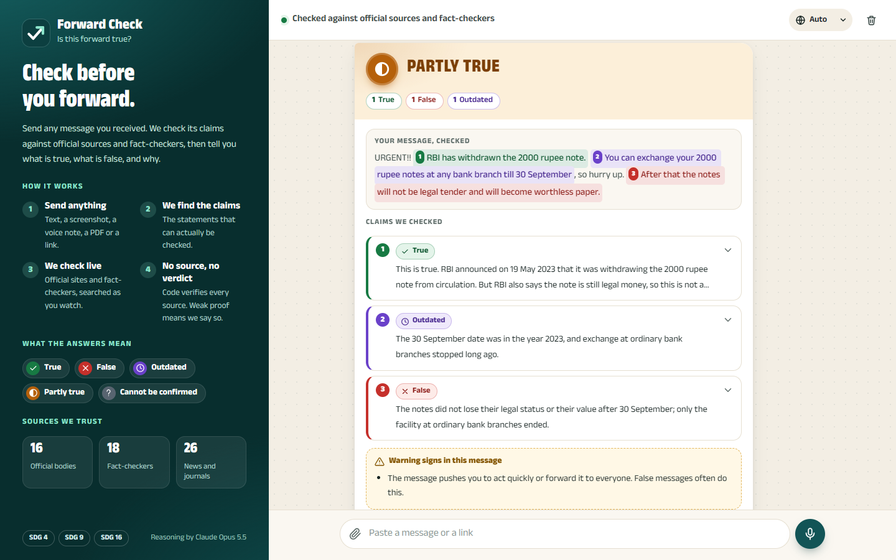
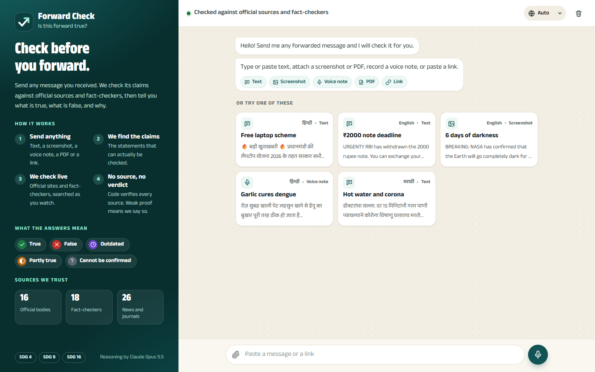
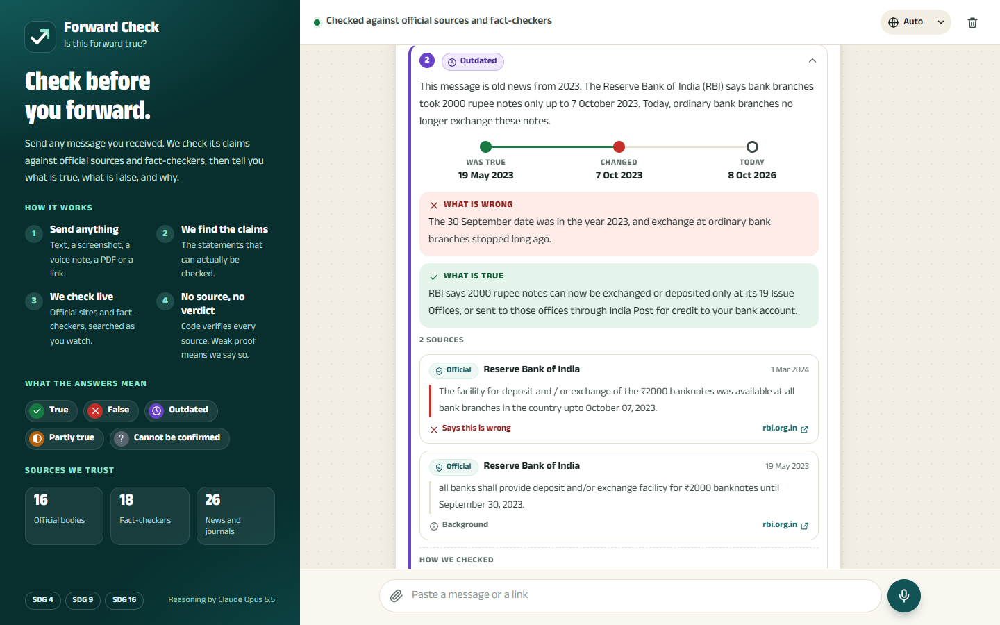
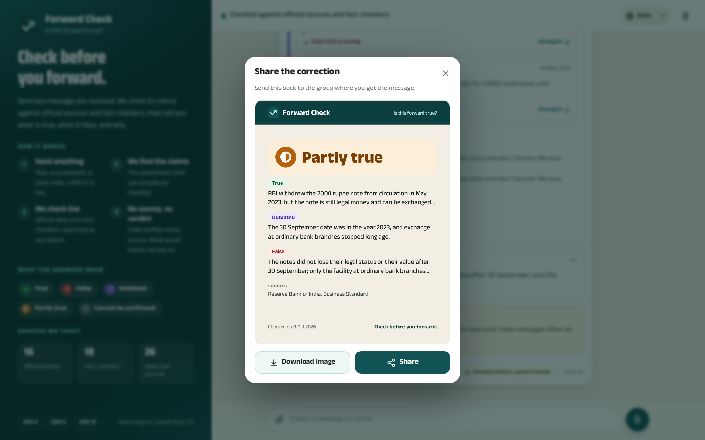
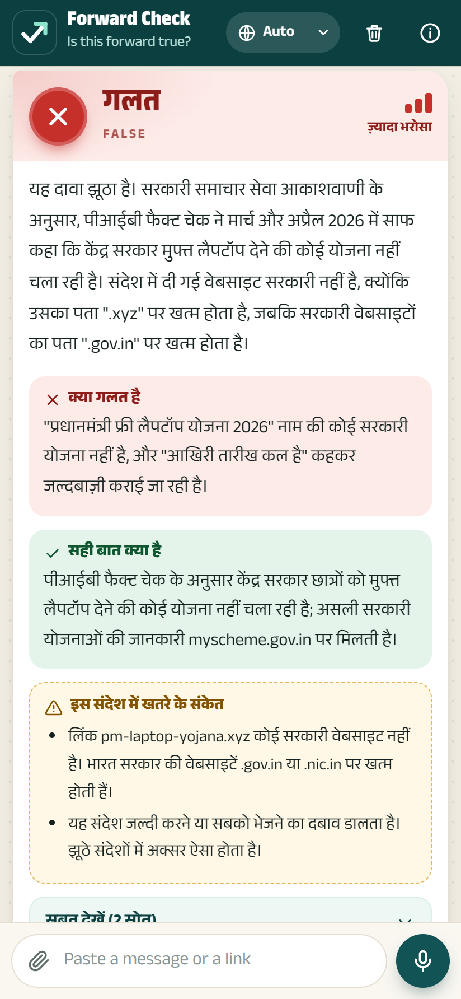
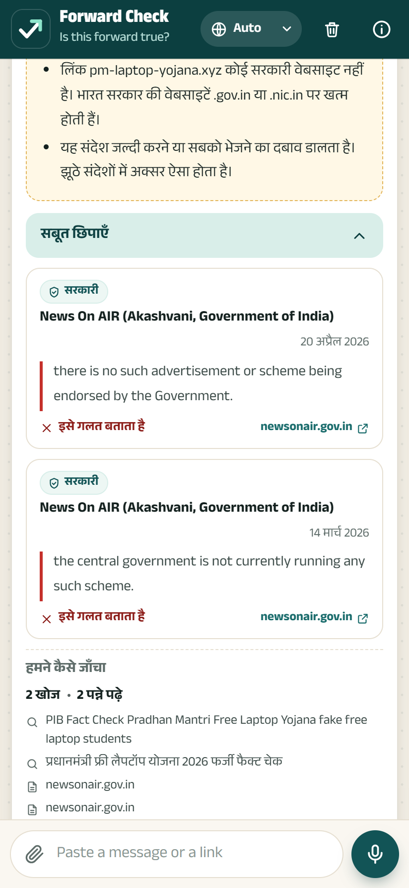
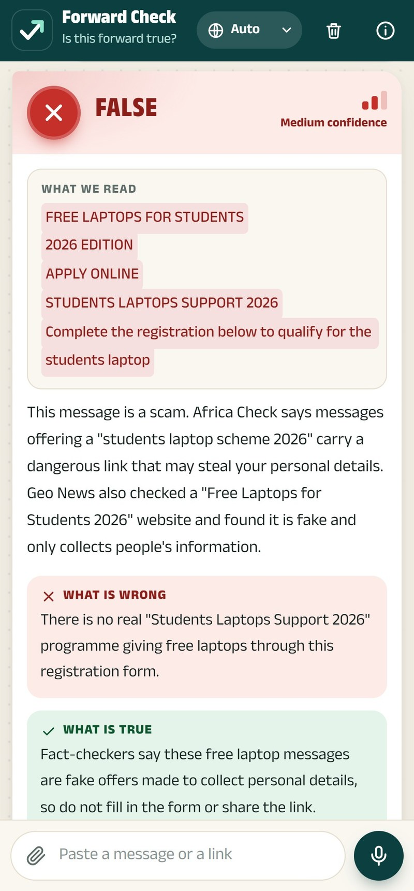
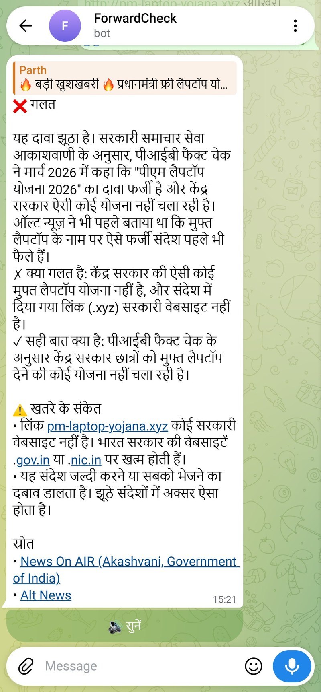
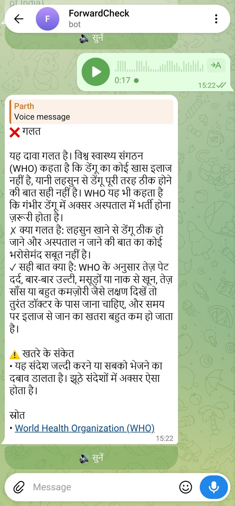

# Forward Check

**Check before you forward.** Send it any forwarded message (text, a screenshot, a voice note, a PDF or a link) and it checks the claims against official sources and fact-checkers, shows the evidence, and explains the result in the language of the message.

Every claim gets one of five verdicts: True, False, Outdated, Partly true, or Cannot be confirmed. The model only proposes a verdict; code checks every citation and withdraws any verdict that has no trusted source behind it.



Built for the hackathon problem statement "Is This Forward True" (Generative AI; SDGs 4, 9 and 16). A 58-second narrated demo is in [`video/forward-check-demo.mp4`](video/forward-check-demo.mp4).

## Screenshots

| Start screen | Evidence for one claim | Correction card to share |
|---|---|---|
|  |  |  |

| Hindi answer on a phone | Its proof | A real viral poster, checked | Telegram: text | Telegram: voice message |
|---|---|---|---|---|
|  |  |  |  |  |

## Install

Developed and tested on Windows 11. The code is plain Python and should run on macOS and Linux with the equivalent commands, but that has not been tested.

**You need**

- Python 3.11 or newer.
- The [Claude Code](https://claude.com/claude-code) command-line tool, installed and signed in. Forward Check runs Claude Opus 5.5 through it, on whatever Claude plan that login has. On Windows: `winget install Anthropic.ClaudeCode`, then run `claude` once and sign in.
- A Google AI Studio API key (free tier is enough). It transcribes voice notes and is the fallback model.
- A Google Cloud API key with the **Fact Check Tools API** enabled. It looks up fact-checks that are already published. Without it the app still works; it just skips that lookup.
- For the Telegram bot only: a bot token from **@BotFather**.

**Set up**

```powershell
git clone https://github.com/dev-parthdeshmukh/forward-check.git
cd forward-check
py -3.11 -m venv .venv
.\.venv\Scripts\python.exe -m pip install -r requirements.txt
copy .env.example .env          # then open .env and paste in your keys
.\.venv\Scripts\python.exe -m pytest -q     # optional: 57 tests, no keys or internet needed
```

## Use

### Web app

Double-click `start.bat`. It starts the server and opens `http://127.0.0.1:8000`. Without the batch file:

```powershell
.\.venv\Scripts\python.exe -m uvicorn app.main:app --port 8000
```

1. **Send a forward.** Paste text or a link, attach a screenshot, PDF or audio file with the paperclip (or drag it in), or record a voice note with the microphone button. The example cards on the start screen run real checks.
2. **Watch the check.** A card shows the claims found and, for each, the search being run and the site being read. A check usually takes around half a minute.
3. **Read the verdict.** The coloured band is the overall answer. Below it: what is wrong, what is true, any scam warning signs, and for a message with several claims, one row per claim.
4. **Open the proof.** "See the proof" (or a claim row) shows each source with its type, date, quote and link, and the searches that were made.
5. **Listen, Share, Copy.** Listen reads the answer aloud. Share makes a correction image to send back to the group. Copy puts the answer on the clipboard as text.

The language menu at the top right sets the interface and reply language (English, Hindi, Marathi). On "Auto" each reply follows the language of its message.

To open it on a phone on the same Wi-Fi, add `--host 0.0.0.0` and browse to `http://<this-pc's-ip>:8000`. Browsers only allow the microphone and clipboard on `localhost` or HTTPS, so on the phone the record and copy buttons will not work over plain `http`; attaching a voice-note file does.

### Telegram bot

Put the @BotFather token in `.env` as `TELEGRAM_BOT_TOKEN=...`, double-click `start_bot.bat`, and send your bot any text, photo, voice message, PDF or link. More in [Telegram bot](#telegram-bot-bottelegram_botpy) below.

### Command line and tests

```powershell
.\.venv\Scripts\python.exe -m app.cli "message text"
.\.venv\Scripts\python.exe -m app.cli --file screenshot.png      # also .jpg .webp .pdf .ogg .opus .mp3 .wav .m4a .txt
.\.venv\Scripts\python.exe -m app.cli --url https://example.com/article
.\.venv\Scripts\python.exe -m app.cli "message text" --lang Marathi --json --no-cache
.\.venv\Scripts\python.exe -m pytest -q
```

## Web app (`web/`)

Plain HTML, CSS and JavaScript modules served by FastAPI; there is no build step.

| File | What it holds |
|---|---|
| `js/app.js` | Composer, examples, sending a check, chat history (kept in the browser) |
| `js/result.js` | The live progress card and the result card |
| `js/share.js` | The correction image drawn on a canvas |
| `js/recorder.js` | Voice recording, converted to WAV in the browser |
| `js/i18n.js` | All interface text in English, Hindi and Marathi |
| `css/app.css` | Styling; colours and sizes are variables at the top |
| `demo/` | The screenshot and voice note behind two of the example cards |

The language menu sets the interface language and the reply language. On "Auto" the interface follows the browser and each reply follows its message.

## API

| Endpoint | Purpose |
|---|---|
| `POST /check/stream` | Form fields `text`, `url`, `file`, `reply_language`. Streams progress as JSON lines, ending with a `result` or `error` line. The web app uses this. |
| `POST /check`, `POST /check/file` | The same check, returning only the final result |
| `POST /tts` | `{"text", "language_code"}` to MP3, for the Listen button (Microsoft Edge voices, needs internet) |
| `GET /meta` | Model name, trusted-source counts, voices |

## Telegram bot (`bot/telegram_bot.py`)

1. In Telegram, open **@BotFather**, send `/newbot`, and follow the prompts. It gives you a token.
2. Put it in `.env` as `TELEGRAM_BOT_TOKEN=...`.
3. Double-click `start_bot.bat` (or run `.\.venv\Scripts\python.exe -m bot.telegram_bot`).

Forward the bot any text, photo, voice note, PDF or link. It shows the searches as they happen, then replaces that with the verdict, reasons, warning signs and source links, with a Listen button for a spoken reply. `/lang hi`, `/lang mr`, `/lang en` or `/lang auto` sets the reply language for that chat. The bot uses long polling, so it runs from a laptop with no public address, and it shares the cache with the web app.

## Evaluation (`eval/`)

```powershell
.\.venv\Scripts\python.exe -m eval.run        # checks every gold item not yet done; resumable
.\.venv\Scripts\python.exe -m eval.report     # writes eval/report.md
```

`eval/gold.json` holds 24 forwards with an expected verdict each, spread over the five verdicts and three languages. Some items list an `accept` verdict where a second answer is defensible (an expired deadline can fairly be called outdated or false); the report gives the exact score and the score counting those. Every run spends model usage, and the run stops if the main backend fails rather than score the fallback.

The gold set is small and its items are clear-cut, well-documented cases written for this project, so a high score shows the pipeline works as designed, not how it does on messy real forwards. Add real ones to `gold.json` to find out.

## Demo video (`video/`)

`video/forward-check-demo.mp4` is a 58-second film with narration and a quiet music bed. `mix.py` also writes `forward-check-demo-voice-only.mp4`, the same film without music (not kept in the repository). The footage is real: live checks in the web app and in the Telegram bot, recorded from Chrome as screenshots and retimed (the film says on screen where time is compressed or skipped).

To rebuild it, run these from `video/` with the project's Python (`..\.venv\Scripts\python.exe`):

| Step | Command | What it does |
|---|---|---|
| Inputs | `make_inputs.py` | Cuts the viral poster out of PIB Fact Check's graphic (save it first as `build/web_images/newsonair_laptop.jpg`; the link is in the script) and makes the fake-microphone audio |
| Record the web app | `rec_web.py` | Needs the app on port 8011 with an empty `CACHE_DIR`, so the checks run live |
| Record Telegram | `tg_login.py` once, then `rec_tg.py` | Needs the bot running; sends a text and a voice message to it in Telegram Web |
| Narration | `make_voice.py` | Speaks `narration.json` and saves when each word falls |
| Picture | `render.py film` | Needs `python -m http.server 8020` running in the project root; draws `composition.html` frame by frame |
| Sound | `mix.py` | Places the narration, adds music, writes the two MP4s |

Scene and narration times are in `timeline.json`; the layout, motion and footage timing are in `composition.html`. `render.py stills 12 20.5` writes single frames to check a change. Every recording is a live check and spends model usage. `rec_tg.py` uses a separate Chrome profile that is logged in to your Telegram account. It lives in `video/build/tg-profile` (git-ignored) unless `TG_PROFILE` points elsewhere, and deleting that folder logs it out. The video scripts also need `pip install playwright pillow numpy imageio-ffmpeg` and Google Chrome.

## Cache (`app/cache.py`)

A finished check is stored in `data/cache.db` for `CACHE_TTL_DAYS` (default 7) and reused when the same message, file or link comes in again with the same reply language. Matching is exact apart from letter case and spacing, so a reworded forward is checked afresh. Answers from the fallback backend are not stored. Delete `data/` to clear it.

## Input types (`app/ingest.py`)

| Input | How it is read |
|---|---|
| Text | As is. A message that is only a link is treated as a link. |
| Screenshot / image | Sent to the model, which reads the text and extracts claims in one call. Max 5 MB. |
| PDF | Text layer via `pypdf`. A scanned PDF (no text layer) is sent to the model, up to 20 pages. |
| Voice note | Transcribed by Gemini, then checked as text. Needs `GEMINI_API_KEY`. |
| Link | Page fetched and stripped to text; PDF and image links are handled as those types. Links to private addresses are refused. |

Content over 40,000 characters is cut, and the result says so in `notes`.

On Windows PowerShell, set `$env:PYTHONIOENCODING = "utf-8"` before piping Hindi or Marathi output to a file.

## How it works

1. **Extract** (`app/pipeline/extract.py`): the model lists the independent factual claims and the message language.
2. **Seed** (`app/factcheck.py`): the Google Fact Check Tools API returns published fact-checks that may cover each claim.
3. **Research and judge** (`app/pipeline/research.py`): one model call per claim searches the web, reads pages and proposes a verdict with quoted evidence.
4. **Validate** (`app/pipeline/verdict.py`): code drops any cited URL the model did not actually retrieve, and withdraws a verdict that is left without a trusted source. The trusted list is in `app/sources.py`.

## Verdict rules (`app/pipeline/verdict.py`)

The model proposes a verdict; code decides whether it stands. A verdict is withdrawn to `UNVERIFIABLE` when:

- it has no evidence from a trusted source, or none with the stance the verdict needs (`VERIFIED` needs a supporting source, `FALSE` a refuting one);
- a cited URL was never retrieved in that run (the entry is dropped first);
- the only support is the page being checked, unless that page is an official or fact-checker source;
- `OUTDATED` has no usable date, or its change date is in the future.

Confidence is capped at medium for a single news report, for a verdict resting only on the checked page, and for a `VERIFIED` scheme, finance or alert claim whose newest supporting source is over two years old. It is capped at low when trusted sources disagree.

`app/pipeline/risk.py` adds warning signs from the message text by rule, with no model call: a non-government link in a scheme message, a shortened link, mention of OTP or bank details, and pressure to act fast or forward. Labels and fixed messages are in `app/i18n.py` (English, Hindi, Marathi).

## Configuration (`.env`)

| Variable | Default | Meaning |
|---|---|---|
| `LLM_BACKEND` | `claude_cli` | `claude_cli` (Claude Code CLI, uses the logged-in subscription) or `gemini` |
| `LLM_FALLBACK` | `gemini` | Backend tried when the first one fails |
| `CLAUDE_MODEL` | `claude-opus-5-5` | Model for the Claude backend |
| `GEMINI_MODEL` | `gemini-3.1-flash-lite` | Model for the Gemini backend |
| `JUDGE_EFFORT` | `low` | Effort for the research call (`low` to `max`) |
| `CACHE_TTL_DAYS` | `7` | How long a finished check is reused |
| `GEMINI_API_KEY`, `FACTCHECK_API_KEY` | | API keys |
| `TELEGRAM_BOT_TOKEN` | | Token from @BotFather, for the Telegram bot |

The Gemini backend has no web search on a free-tier key, so it judges only from published fact-checks and abstains otherwise.
